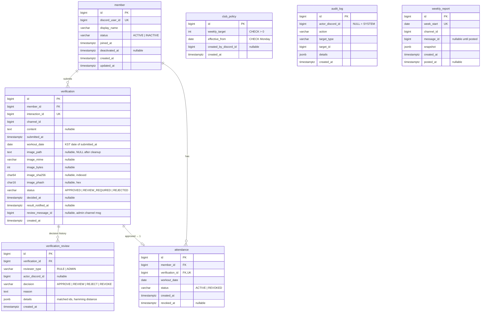
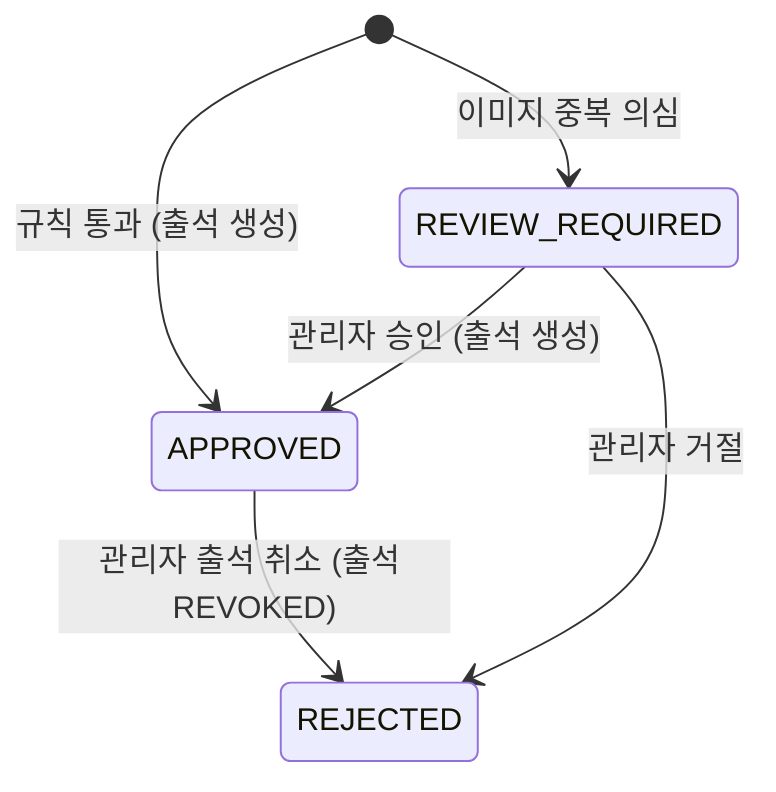

# 시스템 구조

## 1. 전체 구조

하나의 Python 프로세스(discord.py 이벤트 루프)에서 모든 기능이 돈다.

```
Discord ──interaction──▶ bot/commands ──▶ app/services ──▶ app/repositories ──▶ PostgreSQL
                         bot/views          │
                         bot/events         ├─▶ app/image (다운로드·검증·해시·저장) ──▶ 이미지 볼륨
                         bot/tasks ─────────┘
```

| 계층 | 책임 | 하지 않는 것 |
|---|---|---|
| `bot/commands`, `bot/views` | 입력 파싱, 권한 확인, defer, 서비스 호출, Embed 렌더링 | 비즈니스 규칙, SQL |
| `bot/events` | 역할 변경·탈퇴 이벤트를 회원 서비스로 전달 | |
| `bot/tasks` | 주기 작업(`discord.ext.tasks`): 리포트, 이미지 정리 | |
| `app/services` | 비즈니스 규칙, 트랜잭션 경계 | Discord 객체 의존 |
| `app/repositories` | 쿼리 | 트랜잭션 커밋 |
| `app/image` | 다운로드, 형식·용량 검증, SHA-256/pHash, 파일 저장·삭제 | DB 접근 |
| `app/core` | 설정, DB 세션, 시간 유틸(Clock, KST 주 계산), 예외 | |

서비스는 Discord 타입 대신 원시값(ID, 문자열, bytes)과 DTO만 받는다. 그래서 Discord 없이 테스트할 수 있다.

## 2. 디렉터리

```text
bot/
  main.py                # 진입점: 설정 로드, DB 엔진, Bot 생성, setup_hook
  checks.py              # 회원/관리자 역할 확인
  notify.py              # 지난 결과 알림을 모든 명령 응답에 붙이는 헬퍼
  commands/
    verification.py      # /인증
    me.py                # /내출석 /내기록 /랭킹 /목표 /도움말
    admin.py             # /관리 그룹
  views/
    review_view.py       # 승인/거절/출석취소/상세 버튼(DynamicItem, 재시작 후에도 동작) + 사유 모달
    pagination_view.py
    confirm_view.py      # 이번 주 목표 변경 확인
  embeds/
    common.py            # 날짜 표시, 진행 막대
    verification.py
    statistics.py
  events/
    members.py           # on_member_update / on_member_remove / 시작 시 동기화
  tasks/
    weekly_report.py
    image_cleanup.py
app/
  core/      config.py database.py clock.py week.py exceptions.py
  models/    base.py member.py verification.py attendance.py policy.py audit.py report.py
  repositories/  member.py verification.py attendance.py policy.py audit.py report.py
  services/  member_service.py verification_service.py attendance_service.py
             review_service.py policy_service.py statistics_service.py
             notification_service.py report_service.py image_cleanup_service.py
  image/     fetcher.py processor.py hashing.py storage.py
scripts/     backup.sh restore.sh   # pg_dump 백업과 복원
migrations/
tests/
  unit/          # 시간 계산, 해시, 판정 규칙, 이미지 검증
  integration/   # 실제 PostgreSQL 상대로 서비스 전체 흐름
```

v1의 `app/domain/`, `app/ai/`, `app/workers/`, `app/scheduler/`는 두지 않는다(ADR-0002, 원칙 13).

## 3. 데이터베이스

### 3.1 ERD



### 3.2 제약조건과 인덱스

| 대상 | 정의 | 목적 |
|---|---|---|
| `verification` | `UNIQUE (interaction_id)` | 같은 명령의 중복 처리 방지 |
| `verification` | `UNIQUE (member_id, workout_date) WHERE status IN ('APPROVED','REVIEW_REQUIRED')` | 하루 1회 인증. 거절된 날은 재제출 허용 |
| `verification` | `INDEX (image_sha256)`, `INDEX (status) WHERE status='REVIEW_REQUIRED'` | 중복 탐지, 검토 목록 |
| `attendance` | `UNIQUE (member_id, workout_date) WHERE status='ACTIVE'` | 하루 1회 출석. 취소 후 재생성 허용 |
| `attendance` | `UNIQUE (verification_id)` | 인증 1건에 출석 1건 |
| `club_policy` | `CHECK (EXTRACT(ISODOW FROM effective_from) = 1)` | 적용일은 항상 월요일 |
| `weekly_report` | `UNIQUE (week_start)` | 리포트 중복 게시 방지 |

- Discord ID(snowflake)는 모두 `BIGINT`로 저장한다.
- 상태 값은 `VARCHAR`와 `CHECK` 제약으로 둔다. PostgreSQL ENUM은 마이그레이션이 번거로워 쓰지 않는다.

### 3.3 불변성

- `verification`의 원본 필드는 INSERT 이후 변경하지 않는다. 대상: `content`, `submitted_at`, `workout_date`, 해시.
  - 예외는 `image_path`뿐이다. 커밋 후 파일을 저장하면 경로를 기록하고, 이미지 정리 시 NULL로 바꾼다.
  - `image_path`는 `IMAGE_DIR` 기준 상대 경로다.
- `verification.status`는 현재 상태를 담는 캐시다. 모든 변경은 `verification_review`에 이력으로 남긴다.
- `verification_review`, `audit_log`, `club_policy`는 INSERT만 한다.

### 3.4 인증 상태 전이



이 외의 전이는 모두 조건부 UPDATE가 0행이 되어 거부된다.

## 4. 주요 흐름

### 4.1 `/인증`

```mermaid
sequenceDiagram
    participant U as 회원
    participant C as commands/verification
    participant S as VerificationService
    participant I as app/image
    participant A as AttendanceService
    participant DB as PostgreSQL
    U->>C: /인증 내용, 사진
    C->>C: defer(ephemeral)
    C->>S: submit(user_id, interaction_id, created_at, content, attachment_info)
    S->>DB: 회원 확인, 오늘 인증 존재 여부 조회
    S->>I: download + validate + hash
    S->>DB: 기존 sha256/phash 조회
    S->>S: 판정 (RuleDecision)
    S->>DB: BEGIN; INSERT verification, verification_review
    S->>A: (APPROVED면) create_attendance(같은 세션)
    S->>DB: COMMIT
    S->>I: 이미지 파일 저장 (verification_id로 이름)
    S-->>C: SubmissionResult
    C-->>U: ephemeral Embed (결과 + 주간 진행률)
    C->>C: REVIEW면 관리자 채널에 검토 메시지 게시
```

- 파일은 커밋 후에 저장한다.
  - 파일 저장에 실패하면 `image_path`는 NULL로 남고 경고 로그를 남긴다. 해시는 이미 저장되어 있다.
  - 커밋 실패 후 파일만 남는 고아 파일은 생기지 않는다.
- 부분 유니크 인덱스를 위반하면(동시 제출) `AlreadyVerifiedToday`로 변환해 응답한다.

### 4.2 관리자 승인·거절·취소

`ReviewService`의 처리:
- 조건부 UPDATE로 상태를 바꾼다.
- `verification_review`와 `audit_log`를 남긴다.
- `AttendanceService.create` 또는 `revoke`를 호출한다.
- `result_notified_at`을 NULL로 둔다.

이 모든 작업이 하나의 트랜잭션이다. 자동 승인과 관리자 승인은 같은 `AttendanceService.create`를 쓴다.

### 4.3 지난 결과 알림

- 규칙으로 판정된 인증은 그 자리에서 결과를 보여주므로, INSERT할 때 `result_notified_at = now()`로 저장한다.
- 관리자가 결정한 인증은 `result_notified_at = NULL`로 둔다.

모든 회원 명령은 응답 후 `bot/notify.py`를 호출한다. 이 헬퍼는 다음을 처리한다.
- `status <> 'REVIEW_REQUIRED' AND result_notified_at IS NULL`인 본인 인증을 찾는다.
- 찾은 결과를 ephemeral followup으로 보낸다.
- 보내기 전에 조건부 UPDATE로 `result_notified_at`을 먼저 기록(선점)한다. 동시에 명령을 여러 번 실행해도 한 번만 전달된다.

### 4.4 주기 작업

| 작업 | 주기 | 동작 |
|---|---|---|
| `weekly_report` | 5분마다 + 시작 직후 | 지금이 이번 주 월요일 `REPORT_HOUR` 이후이고 지난주 리포트가 게시되지 않았다면 게시 |
| `image_cleanup` | 하루 1회 + 시작 직후 | 보관 기간이 지난 이미지 파일 삭제, `image_path` NULL |
| 회원 동기화 | 시작 시(`on_ready`) | 길드 멤버의 역할 보유 여부와 DB 상태 맞추기 |

## 5. 시간 처리

- `app/core/clock.py`의 `Clock`이 현재 시각을 제공하고, 테스트에서는 고정 시각을 주입한다.
- `app/core/week.py`가 다음 함수를 제공한다.
  - `to_kst_date(ts)`
  - `week_start(date)` (월요일)
  - `week_bounds_utc(week_start)` (반열린 구간 `[월 00:00, 다음 월 00:00)` KST를 UTC로 변환)
- 출석일은 `interaction.created_at`(Discord가 기록한 시각) 기준이다. 서버의 처리 지연이 날짜에 영향을 주지 않는다.

## 6. 기술 스택

| 영역 | 선택 |
|---|---|
| 런타임 | Python 3.12+, uv(패키지 관리) |
| Discord | discord.py 2.x |
| DB | PostgreSQL 17, SQLAlchemy 2.x async, asyncpg, Alembic |
| 이미지 | Pillow, numpy (pHash는 imagehash와 같은 알고리즘을 직접 구현. scipy 의존성을 빼서 이미지 크기를 절반으로 줄임. 결과가 같은지는 테스트로 확인) |
| 설정 | pydantic-settings |
| 주기 작업 | `discord.ext.tasks` (APScheduler 미사용, ADR-0002) |
| 테스트 | pytest, pytest-asyncio, docker compose의 실제 PostgreSQL |
| 배포 | Docker Compose (`bot`, `db`, 이미지·DB 볼륨) |
| 백업 | `pg_dump` 일일 백업 스크립트 (Phase 5) |
